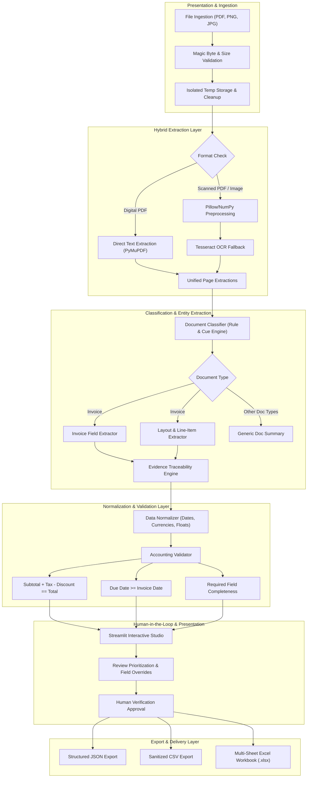

# Document AI - Architecture & System Design

This document describes the architectural design, component boundaries, data flow pipelines, and security mechanisms of the Intelligent Document Processing (IDP) system.

---

## 1. System Architecture Overview

The system is built as a modular, pipeline-oriented Python architecture with strict separation of concerns across ingestion, extraction, classification, parsing, normalization, validation, and export layers.

---

## 2. Core Subsystems

### A. Safe Ingestion (`document_ai.ingestion`)
- **Magic Byte Verification:** Inspects binary headers (`%PDF`, `\x89PNG`, `\xff\xd8\xff`) to guarantee file authenticity rather than trusting extension strings.
- **Configurable Resource Limits:** Rejects files exceeding `MAX_UPLOAD_SIZE_MB` (default 25 MB) and PDFs exceeding `MAX_PDF_PAGES` (default 50 pages).
- **Guaranteed Cleanup:** Uses Python context manager (`temporary_upload_file`) guaranteeing deletion of temporary disk buffers on both success and exception paths.

### B. Hybrid Text Extraction (`document_ai.pdf_processor` & `document_ai.ocr_engine`)
- **Direct PyMuPDF Extraction:** Direct text extraction on native digital PDFs without expensive OCR overhead.
- **Scanned Page Detection:** Pages containing fewer than `min_digital_text_chars` (default 30 chars) are flagged as scanned.
- **Graceful OCR Fallback:** Checks for Tesseract executable on PATH or `.env` `TESSERACT_CMD`. When unavailable, returns clear diagnostic warnings and continues digital extraction without crashing.
- **Pillow Preprocessing:** Applies autocontrast dynamic range normalization, median noise filtering, and Otsu's binarization prior to OCR.

### C. Explainable Document Classifier (`document_ai.document_classifier`)
- Evaluates weighted domain keywords across 5 standard business document types:
  - **Invoice** (`tax invoice`, `bill to`, `amount due`, `remittance`, `subtotal`)
  - **Receipt** (`pos terminal`, `cashier`, `register #`, `change due`, `items sold`)
  - **Purchase Order** (`purchase order`, `po number`, `vendor order`, `requisition`, `ship to`)
  - **Contract** (`agreement`, `whereas`, `in witness whereof`, `governing law`, `indemnification`)
  - **Business Report** (`executive summary`, `quarterly/annual report`, `key findings`, `table of contents`)
- Low confidence or unmapped documents are classified as `unknown` with `requires_human_review = True`.

### D. Entity Extraction & Evidence Traceability (`document_ai.field_extractor`)
- **Label-Aware Regular Expressions:** Contextual pattern matching extracting invoice number, dates, parties, currency, line items, and financial totals.
- **Evidence Traceability (Differentiator 1):** Every extracted field attaches a `FieldEvidence` record containing:
  - `page_number`: Exact page source
  - `matched_text`: Literal string matched
  - `context_snippet`: Surrounding line context
  - `confidence`: Heuristic reliability score

### E. Table & Line-Item Extractor (`document_ai.table_extractor`)
- Identifies table headers via column cues (`Description`, `Qty`, `Unit Price`, `Line Total`).
- Parses item rows deterministically until reaching accounting termination rows (`Subtotal`, `Total`, `Tax`).
- Checks internal arithmetic consistency (`qty * unit_price == line_total`).

### F. Validation & Accounting Audit (`document_ai.validator`)
- Evaluates accounting formulas:
  $$\text{Subtotal} + \text{Tax} - \text{Discount} = \text{Total Amount} \quad (\pm \text{tolerance})$$
- Verifies line item sum against reported subtotal.
- Flags inverted date sequences (`due_date < invoice_date`) and negative amounts.
- Categorizes findings into `ERROR`, `WARNING`, and `INFO`.

### G. Human Review & Prioritization (Differentiator 2)
- Highlights missing, ambiguous, or arithmetic-failing fields in the Streamlit UI.
- Allows operators to edit field values and approve records before exporting.
- Original raw extracted values and evidence are preserved in `user_overrides`.

### H. Multi-Format Exporters (`document_ai.exporters`)
- **JSON:** Complete typed schema with metadata, pages, evidence, and validation.
- **CSV:** Flattened summary record and line-items table. Sanitizes CSV injection prefixes (`=`, `+`, `-`, `@`) to protect spreadsheets against formula injection exploits.
- **Excel (.xlsx):** Multi-tab workbook (`Invoices_Summary` and `Line_Items`) generated using `pandas` and `openpyxl`.
